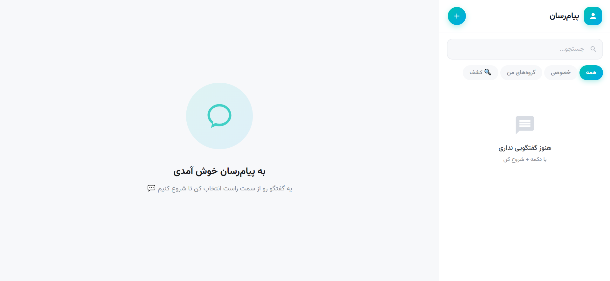

# 💬 Realtime Messenger — Django + WebSocket



A production-ready real-time messaging application built with **Django Channels** and **WebSocket**, supporting private chats, group chats, instant message editing/deletion, and OTP-based authentication.

Fully **Dockerized** with **PostgreSQL** as the primary database and **Redis** as the channel layer.


---

## 📌 About The Project

**Realtime Messenger** is a full-featured messaging platform built to demonstrate strong backend skills in **Django**, **Django Channels**, **WebSocket communication**, and **Docker-based deployment**. The main focus of this project is on **Backend Architecture**, **Real-time Communication**, and **Async Programming**.

### ✨ Why This Project?

- ✅ Complete **WebSocket** implementation using `AsyncWebsocketConsumer`
- ✅ **Real-time** bidirectional communication between multiple users
- ✅ **OTP-based authentication** (passwordless login)
- ✅ **Dockerized** with `docker-compose` (App + PostgreSQL + Redis)
- ✅ **PostgreSQL** as the primary database
- ✅ **Redis** as the channel layer for production
- ✅ Clean and modular Django architecture

---

## 🚀 Quick Start with Docker

### Setup Commands

**Just run these two commands and you're done:**

```bash
# 1. Build and run the containers
docker compose up --build

# 2. Create an admin user (in a separate terminal)
docker compose exec app python manage.py createsuperuser
